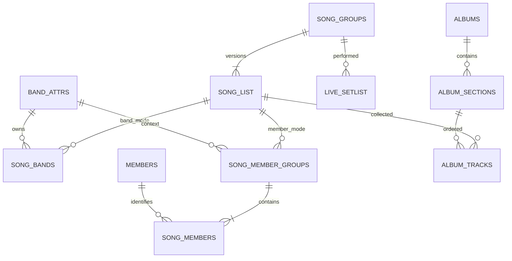

# 歌曲资料、歌曲组与专辑实现设计

## 1. 文档定位与范围

三页增量契约与验收要求见[三页交付标准](song-catalog-three-page-delivery.md)。公共页面采用概览 A、详情 D、唱片 A；本文件第 9 节记录当前接入结构。主体数据模型与维护权限沿用原规则。

业务规则以[歌曲资料、详情与专辑关联需求](../product/song-details-and-albums.md)为准。未审核的版本归属允许 pending。

专辑页面链接与多封面已实现，字段为 `album_url` / `cover_urls`。存储、校验和交互见[专项实现说明](album-links-and-covers.md)。

已确认的产品边界：

- 公共导航在“巡演资料”和“数据统计”之间加入“歌曲资料”。目录按歌曲组展示摘要并跳转独立详情；详情切换版本保持歌曲组次数和关联歌单一致。
- 控制台拆为“新增歌曲／歌曲管理”两个入口，复用演出新增 / 管理的交互结构；公共页与 Console 的页面结构分别设计。
- `song_id` 对应专辑收录的具体版本，歌单使用 `song_group_id`；固定合唱阵容、独立编曲与普通版属于同一歌曲组。
- 每个版本支持乐队模式、成员模式及同时保存两类关系的混合模式。乐队模式可包含多支乐队；成员模式保存固定成员及其对应乐队分组。
- 三种完整归属模式的现场翻唱均只比较乐队交集：任一实际出演成员所在的 setlist 乐队命中基准乐队，即不是现场翻唱。
- Instrumental 只是专辑收录标识，复用对应非 Instrumental 的 `song_id`，不产生新版本。
- 专辑发售日期为完整年月日或未知；歌曲不保存发售日期。专辑发行标识为自由文本，不拆类型、序号或碟号。
- 演奏次数按有效 setlist 记录计数。短版正常计数，仅在对应条目后标记。
- 延期调整必须指定新日期；已有歌单后不得修改演出日期，未来或取消 Live 不允许有歌单。
- 成员首次按需求文档的固定 67 人顺序编号；专辑手动维护页面链接和封面数组，数组第一项为默认封面。

本文确定技术结构；三页页面标准以专项交付文档为准。手工数据维护边界见第 15 节，审核规则以回填输入为准。

## 3. 概念模型与 ID 规则



两类归属可以同时存在，使用 `mixed` 模式；`bands` 只含整队关系，`members` 只含成员关系，`mixed` 两类均非空，`pending` 两类均为空。

| 标识 | 含义 | 稳定性 |
| --- | --- | --- |
| group_id | 一首歌的共同身份，供左列表展示 | 合组不改已有 song_id；不按同名自动合组 |
| song_id | 专辑实际关联的版本；历史歌单以歌曲组为身份 | 延续当前 song_list.id，不因新建歌曲组重新编号 |
| member_id | 自然人的全局身份 | 同人在不同乐队共用，补录不重排 |
| album_id | 一份专辑资料 | 名称相同不自动合并 |
| album_track_id | 一次收录关系 | 同一专辑可多次指向同一 song_id |
| setlist_id | 一次独立演奏记录 | 统计按记录计次，不按 Live 去重 |

`group_name` 是歌曲名称的唯一存储位置，同组全部版本共用该名称；`version_label` 是“三乐队合唱版”等可选自由文本，空值表示默认版本。版本不独立存储或编辑歌曲名称；读取响应中的 `song_name` 从所属组派生。名称相同既不等于同组，也不等于同一个版本。

## 4. 数据库结构

V40 已实现歌曲组歌单引用、混合归属和专辑子项。`live_setlist.song_id` 仅保留旧来源，新歌单只写 `song_group_id`。`album_sections` 保存 `album_id / section_name / display_order`；`album_tracks` 使用 `section_id`，并以复合外键保证子项属于本专辑。控制台通过收录行的 `section_name` 维护子项，顺序按提交列表中的首次出现确定，曲序分别从 1 开始。正式回填文件见 `backfill/song-catalog-2026-09-26/`。


以下是目标结构说明，不是可直接执行的 Flyway 文件。字段名可在实现时随项目命名规范微调，语义及约束不得改变。

### 4.1 歌曲组与具体版本

**新增 `song_groups`**

| 字段 | 类型及约束 | 用途 |
| --- | --- | --- |
| id | integer identity，PK | group_id |
| group_name | text，非空非空白 | 列表标题；不全局唯一 |
| revision | bigint，非空，初始 1 | 管理端并发编辑校验 |

**扩展 `song_list`**

| 字段 | 类型及约束 | 用途 |
| --- | --- | --- |
| id | 保留现有 integer PK | song_id |
| group_id | integer FK → song_groups | 扩展迁移填充后非空 |
| version_label | text，非空，默认空字符串 | 空字符串表示歌曲组的默认项，作为现场判定基准 |
| version_order | integer > 0 | 组内切换顺序，不是专辑曲序 |
| owner_mode | text，`bands` / `members` / `mixed`；迁移期可空 | 归属模式 |
| revision | bigint，非空，初始 1 | 版本及其子关系的并发编辑校验 |
| band_id | 扩展阶段保留旧列，允许空 | 历史兼容证据；最终删除 |
| is_cover | 暂保留旧列 | 历史人工属性，不作为新现场判定输入 |

组内唯一规则设计：

- `UNIQUE(group_id, version_order)`，可延迟到事务结束检查，便于交换顺序。
- `UNIQUE(group_id, version_label)`；写入先 trim，空标识在一组内最多一个。第二个版本如果未能消歧，要求补充版本标识；这是建议的管理校验规则。
- 不把成员数组或乐队数组的展示顺序纳入身份。不以旧 `(song_name, band_id)` 约束继续限制多乐队、成员模式。
- 同样归属可以有不同编曲版本，因此不对“组＋归属集合”单独设唯一键。
- 组至少含一个版本：新建组与首个版本同事务完成；运行时不提供空组保存和删除最后版本的入口。组重分配后清理空组，不留下公开空组。
- 版本冲突返回 409，不能用名称冲突自动合并已有歌单或专辑关系。

组管理和版本迁移按 group_id 升序加锁，再锁 song_id；改组只修改版本的 group_id / 顺序，不更新 live_setlist.song_id。以 `/songs/{song_id}` 发出的链接因此继续有效。删除有歌单或专辑引用的版本使用 RESTRICT，不级联删除业务记录。

### 4.2 乐队模式

`song_bands(song_id, band_id, display_order)`：

- PK `(song_id, band_id)`，分别引用 song_list / band_attrs。
- band_id > 0；`0 / Other bands` 不能成为未知归属的占位值。
- `UNIQUE(song_id, display_order)`，顺序为正整数。
- 删除版本时仅可级联清理本表关系；删除乐队使用 RESTRICT。
- 两支乐队的顺序调整只改变展示，不改变翻唱结果。

### 4.3 成员模式

采用关系表存储，JSON 只作 API 交换，确保 ID 引用可验证。

| 表 | 字段与关键约束 |
| --- | --- |
| members | `id integer identity PK`、`display_name text NOT NULL`、`revision bigint`；姓名非空白但不唯一 |
| song_member_groups | `song_id, band_id, display_order`；PK `(song_id, band_id)`；组内乐队与顺序去重，band_id > 0 |
| song_members | `song_id, band_id, member_id, display_order`；FK `(song_id, band_id)` → song_member_groups；member_id FK → members |

本设计先按需求文档的去重建议采用 `PRIMARY KEY(song_id, member_id)`，同一歌曲版本中同一人选一次；`UNIQUE(song_id, band_id, display_order)` 维护组内顺序。若未来确实需要同一个人在同一版本下同时归到多个乐队，应单独确认并改用三列键，不能在当前表中悄悄重复人物。

每个成员分组必须至少有一人；对应 band_id 是创建版本时固定保存的上下文，参与现场翻唱判定，不能根据成员当前所在乐队实时推导。候选可利用历史阵容提供，但不强制成员必须仍在当前阵容内，否则无法记录已离队人员或历史合作。

### 4.4 专辑与收录

| 表 | 字段 | 约束 |
| --- | --- | --- |
| albums | `id integer identity`、`album_name text` | PK；名称非空白，不全局唯一 |
| albums | `release_label text NULL` | 如 10th single；trim 后空串归一为 NULL，不解析或枚举 |
| albums | `release_date date NULL` | NULL 表示未知；API 只接受 `YYYY-MM-DD` 或 null |
| albums | `album_url text NULL` | 专辑公告或平台详情页的 HTTPS 地址，未补录时为空 |
| albums | `cover_urls jsonb NOT NULL DEFAULT '[]'::jsonb` | 有序 `{ url, name }` 封面数组（V43）；名称选填，第一项默认，无图时为空数组 |
| albums | `revision bigint NOT NULL DEFAULT 1` | 包含曲目关系的编辑版本 |
| album_tracks | `id bigint identity PK`、`album_id`、`song_id` | 两个外键；删除歌曲 RESTRICT，删除专辑需先显式处理曲目 |
| album_tracks | `track_order integer > 0`、`edition_label text NULL` | 专辑子项内排序；Instrumental 标识位于 edition_label |

`UNIQUE(section_id, track_order) DEFERRABLE INITIALLY DEFERRED`；不设 `(album_id, song_id)` 唯一限制。调整顺序时锁专辑，提交完整顺序，在一个事务内更新；缺项、重复项、跨专辑曲目 ID 均拒绝。

普通版收录和 Instrumental 收录分别占一条 album_tracks，但它们的 song_id 相同。点击任意一条均跳转该 song_id。edition_label 不参与现场版本选择、统计或歌曲组划分。

歌曲详情按 album_id 聚合关联专辑，避免同张专辑因普通 / Instrumental 两条收录重复显示两张封面。专辑曲目详情仍返回完整两条及各自 track_order；歌曲详情不显示曲序。

### 4.5 跨表完整性

不能用普通 CHECK 查询子表来保证归属完整性。采用本行 CHECK / FK / UNIQUE，加锁和可延迟约束触发器组合；PostgreSQL 对跨表 CHECK 的限制见[官方约束文档](https://www.postgresql.org/docs/current/ddl-constraints.html)。

| owner_mode | song_bands | song_member_groups / song_members | 合法阶段 |
| --- | --- | --- | --- |
| NULL | 必须空 | 必须空 | 仅迁移回填期 |
| bands | 至少一行 | 必须空 | 所有阶段 |
| members | 必须空 | 至少一组，每组至少一人 | 所有阶段 |
| mixed | 至少一行 | 至少一组，每组至少一人 | 所有阶段 |

具体约束方案：

1. 所有归属关系写入先锁 song_list 父行。子表触发器也锁相同父行，避免绕过 API 的并发子表修改产生写偏差。
2. song_list 及三张归属表的 INSERT / UPDATE / DELETE 均安排归属检查；检查最终事务状态。变更外键时覆盖 OLD / NEW 两个父 ID，按升序锁定。
3. 使用 AFTER ROW 的可延迟约束触发器，不用 WHEN 中的子查询提前判断非空。允许一个事务内“先删除旧关系，再写新关系”，不允许提交中间空状态。参见[CREATE TRIGGER](https://www.postgresql.org/docs/current/sql-createtrigger.html)。
4. 回填期函数允许 NULL＋全部空；收紧迁移替换检查函数并增加 owner_mode NOT NULL。不能仅靠前端开关或环境变量永久绕开数据库约束。
5. 运行时角色没有禁用触发器、修改 schema 或 TRUNCATE 主数据的权限。备份恢复后执行完整性审计，不能因恢复时触发器未运行而跳过验证。

保存任何父实体及子关系只增加一次 revision；独立修改子表也必须经过统一服务入口并锁父对象。版本归属可随整页资料直接编辑并统一保存，独立归属更新接口同样保留 revision 校验和前后快照审计。

### 4.6 索引

新增前核对现有索引，避免重复创建：

- `song_list(group_id, version_order, id)`，由唯一顺序索引覆盖的前缀不再重复。
- `song_bands(band_id, song_id)`、`song_member_groups(band_id, song_id)`，用于归属筛选。
- `song_members(member_id, song_id)`，用于成员影响预览和引用检查。
- `album_tracks(song_id, album_id)`，用于版本关联专辑；子项内顺序由唯一索引支撑。
- `live_setlist(song_group_id)`，用于歌曲组次数和歌单读取。
- members 的姓名普通索引用于候选查询，不以姓名作为身份唯一键。

歌曲小于 500 首、专辑小于 200 张时，先复用现有文本规范化及参数化查询，不新增全文搜索服务或物化计数表。性能判断依据实际查询计划，不为小数据量预先引入额外基础设施。

## 5. 成员 ID 与历史记录衔接

### 5.1 固定初始映射

唯一名单来源是[需求文档 8.1](../product/song-details-and-albums.md#81-成员身份与固定初始顺序)。按其中顺序写入 1–67；第一批完成后，将 identity / sequence 调整到当前最大 ID 之后。编号不按数据库查询自然顺序、乐队 ID 或 Live 日期生成。

首次回填有明确前置条件：目标 members 为空，或每个既有 ID 与预期人物一致；发生占用冲突即停止。重复执行必须验证现有映射相同，不允许 ON CONFLICT 后无条件覆盖姓名。

名字采用当前库内日文 / 拉丁文写法；中文描述只用于确认映射。CRYCHIC 不新增重复人物，sumimi 的佐々木李子和 RAS 的大塚紗英复用已有 ID。同名人员未来仍可不同 ID，因此不能添加 `UNIQUE(display_name)`。

### 5.2 现有阵容和实际出演

为 `band_lineup_version_members`、`live_setlist_band_performance_members` 增加可空 member_id FK：

1. 回填期保留 member_name、display_order、appearance_role 和现有历史阵容上下文，不批量改写出演事实。
2. 用人工审核的“原姓名＋必要的乐队 / 阵容上下文 → member_id”映射填充；无法唯一映射的项单独列出，不模糊匹配相似姓名。
3. 增加 `(lineup_version_id, member_id)`、`(setlist_id, band_id, member_id)` 的唯一约束；成员 ID 完整后，以它们替换姓名构成的主键。NULL 过渡约束不能被当成最终完整性。
4. member_name 可保留为历史显示快照；更新 members.display_name 不自动改写过去的快照。API 同时返回 member_id 和展示名，比较、去重使用 ID。
5. 新增阵容及歌单成员选择器提交 ID；后端从明确 ID 生成展示快照，不能信任客户端传来的名字用于身份匹配。

`live_attrs.event_attendees` 当前还有活动参加者名字，与逐曲出演不是同一对象。本期不得用它参与歌曲翻唱计算。设计建议活动参加者接口增加可空 member_id，以审核映射衔接；旧 JSON 可暂作姓名快照保留，不把当前资料重构扩展成活动参加者存储层重写。

翻唱只需要 setlist 的实际 band_id，已知 band_id 的可靠出演记录不必等待人物 ID 全部回填后才能判定。成员 ID 是人物管理和版本基准的基础，不是把判定改回人物集合比较的理由。

## 6. 现场翻唱与演奏次数

### 6.1 统一计算函数

新增纯函数 `classify_song_performance(owner_band_ids, performer_band_ids, completeness)`，由 Live 详情和歌曲关联歌单共用。成员模式的 owner_band_ids 来自固定成员分组，而非成员当前所属乐队。

```text
基准未确认                         -> unknown(owner_pending)
任一已记录实际乐队命中基准         -> original(band_overlap)
未命中，且现场资料不足             -> unknown(performers_incomplete)
未命中，且现场资料完整             -> cover(no_band_overlap)
```

这里 original 仅表示“本次演奏不是现场翻唱”，不声称它是作品原作者或最初发行者。

P 的来源是 `live_setlist_band_performance_members` 中该 setlist 的 band_id 去重集合，包括已记录的 guest / support；不能用 Live 默认乐队、event_attendees、当前阵容或全部历史任职推导 P。只有乐队父记录却没有实际成员的异常数据不能单独证明“有一位成员出演”。

返回内部原因，API 建议使用：

```json
{
  "classification": "original",
  "reason": "band_overlap",
  "matched_band_ids": [1]
}
```

旧人工 is_cover 独立保留，不用 `is_cover OR 自动结果` 代替本规则。现有兼容标签保留，歌曲 is_cover 以审核表为准。

### 6.2 次数与关联歌单查询

统一定义有效歌单集合 E：Live 未取消，按固定演出时区不在未来，且历史延期 / 时区异常已可确定有效安排。歌曲组次数为 E 中 song_group_id 相同的记录数，同组各版本返回相同次数。归属待回填或翻唱 unknown 不影响有效演奏的计次。

查询顺序：

1. 筛选有效 Live，与 live_setlist 组成基础行，每行只含一个 setlist_id。
2. 在基础行上按 song_group_id 聚合计数，版本接口先解析所属组再查询关联歌单。
3. 分页后再批量读取实际出演乐队和成员，不能先 JOIN 成员再 COUNT(*)。
4. album_tracks 单独查询；封面、专辑重复收录、多人出演均不能放大演奏次数。

关联歌单建议按 `live_date DESC, live_id DESC, absolute_order ASC, setlist_id ASC` 稳定排序；同 Live 两条同曲保留两行。年份筛选作用于关联歌单列表；详情主次数始终是该版本全部有效演奏次数，分页 total 是当前过滤结果，字段不得混用。

一次详情读取中的次数、歌单首屏与 total 使用同一快照；可采用单次 CTE 查询，或只读 REPEATABLE READ 短事务。分开的分页 HTTP 请求可能看到后续编辑后的状态，返回明确 total，不承诺跨请求冻结快照。

## 7. Live 日期有效性与写入锁

### 7.1 固定演出日期基准

新增内部 `live_setlist_policy` 服务及对应 SQL 判定入口。公开页面仍可按访问者时区呈现日期阶段；服务端写入和歌曲计数不得依赖请求中的访问者时区。

建议优先级：物理 / 未公开场馆的 venue.timezone_id → ONLINE 已公布 timetz 中的固定偏移。无可靠时区时返回 `schedule_basis_unknown`，不得默认使用服务器本地时间。无可靠事件时钟的历史数据保持未知，不能用服务器日期推导有效演出。

只存在可靠日期和时区即可判断“当日”；不要求开演时间、完演时间或跨日后才录歌单。SQL 与 Python 使用一致的 as_of 时刻和日期算法；单元测试可传入时刻，不引入生产端任意绕过日期的参数。

### 7.2 事务流程

```text
Console 保存歌单
  -> editor+ / session / CSRF
  -> SELECT Live FOR UPDATE
  -> 获取当前日期和状态，判断可写
  -> 校验 song_group_id、阵容上下文、实际出演
  -> 同事务写 setlist 与成员关系、审计
  -> 提交后清理相关缓存
```

Live 更新也先锁同一 Live 行，再检查歌单是否存在：

- 有歌单且 live_date 改变：409 `live_date_locked`；改成另一个过去日期也拒绝。
- 有歌单且目标为 cancelled：409 `live_has_setlist`。
- 新增 / 替换 / 追加歌单时为未来或取消：409 `live_not_performable`。
- 延期必须提供新的明确日期；旧值不变、缺少新日期不能作为有效延期。是否允许同日时刻调整继续沿用 correction / 日程字段分类，不把全部资料字段锁死。
- 修改场馆或 ONLINE 时间偏移若改变有效日期基准，必须重新校验已有歌单的不变量，不能通过换时区绕过日期锁。

删除 / 替换歌单同样锁 Live，不因“删除后再插入”短暂为空而允许并发修改日期。多 Live 操作按 ID 升序锁定。与父行锁配套的数据库触发器防御直接关系写入，基础权限不开放绕过入口。行锁语义参考[PostgreSQL 显式锁](https://www.postgresql.org/docs/current/explicit-locking.html)。

日期有效性是运行时规则，不写为带 CURRENT_DATE 的普通 CHECK。时区资料变更可能影响已有演出的有效性，场馆时区修改入口也需影响预览和同一规则校验；不能只守住 Live 页面。

### 7.3 既有异常

实现前只读列出未来 / 取消仍有歌单、延期未更新日期、无可靠时区的记录。禁止自动删除；修正由独立回填处理。未知与明确错误分开报告，不在 API 中把 unknown 当 0 次且无任何维护线索。

新公开歌曲统计以规则可确定的数据为准；涉及无法确定有效性的版本，内部质量报告给出受影响 song_id / live_id，完成整理后再开放完整统计，不以猜测日期填平历史数据。

## 8. API 设计

### 8.1 公共只读接口

新增 `routers/songs.py`、`schemas/songs.py`，由 main.py 注册；使用 get_db_connection。下面的路径及参数是实现设计，尚非现有 API。

| 接口 | 主要输入 | 输出 / 行为 |
| --- | --- | --- |
| `GET /api/song-groups` | q、band_id、owner_mode、page、page_size、sort | 每项一个歌曲组；无演奏次数；匹配组内版本后对组去重 |
| `GET /api/song-groups/{group_id}` | group_id | 组标题、按 version_order 的版本候选；各版本展示同一组次数 |
| `GET /api/songs/{song_id}` | song_id | 所属组、具体版本、归属、revision、全部演奏次数及关联专辑 |
| `GET /api/songs/{song_id}/performances` | page、page_size、year | 每条 setlist 一项，含位置、短版、现场判定、实际出演、Live 链接资料 |
| `GET /api/albums/{album_id}` | album_id | 最小专辑资料与按 track_order 排序的收录条目，供关联专辑内容使用 |

q 复用 [song_lookup.py](../../backend/app/song_lookup.py) 及其共享标点配置，匹配组名或版本歌名；不新增不同的正则规范化规则。组列表分页在 DISTINCT group_id 后执行，不能先分页版本再客户端去重。

公共目录建议使用规范化后的包含匹配，现有 Console 候选维持前缀匹配；两者只区分匹配位置，不区分标点等价规则。SQL 中 q、年份和 ID 均参数化，LIKE 的 `%` / `_` 作为用户文本转义。按名称排序时用规范化组名加 group_id 作为稳定次序，不能依赖数据库未指定顺序。

band_id 过滤的建议契约：匹配任一版本的固定 band_id（乐队模式的 song_bands 或成员模式的分组乐队）；返回匹配版本 ID，选组时优先选匹配版本。owner_mode 与 band_id 必须在同一个版本上满足，不能分别命中组内两个版本后误返回。

页面筛选是否向用户开放全部参数继续由后续 UI 决定。技术默认建议 page_size=20、最大 100、sort=name；确定页面排序前不添加隐含组总次数排序。空集合返回 200 和空 items；ID 类型或范围非法为 422，合法 ID 对应的实体不存在为 404。

### 8.2 归属响应

使用判别联合；空值只能表示迁移未确认，不以空数组伪装已确认模式。

```json
{
  "song_id": 1001,
  "group_id": 101,
  "song_name": "示意歌曲",
  "version_label": "三乐队合唱版",
  "version_order": 2,
  "revision": 1,
  "ownership": {
    "mode": "bands",
    "bands": [
      {"band_id": 1, "band_name": "Poppin'Party"},
      {"band_id": 2, "band_name": "Afterglow"},
      {"band_id": 4, "band_name": "Roselia"}
    ]
  },
  "performance_count": 0,
  "albums": []
}
```

成员模式替换 ownership 为 `{"mode":"members","groups":[{"band_id":1,"band_name":"Poppin'Party","members":[{"member_id":1,"display_name":"愛美"}]}]}`；迁移未确认为 `{"mode":null,"status":"pending"}`。上例为接口结构示意，不是真实数据库记录。

Pydantic 与 TypeScript 必须同步声明三种结构；客户端不读取虚构的单值 band_id。歌单实际出演使用单独的 performers 字段，禁止把它装进 ownership。

### 8.3 管理接口

延续 `/api/console` 的 editor+、会话、CSRF、审计和异常转换：

| 接口 | 职责 |
| --- | --- |
| `GET /api/console/songs` | 默认返回具体版本候选；歌单选曲传 groups_only=true，返回每组一个默认项并提交 group_id |
| `GET /api/console/songs/{id}` | 歌曲管理加载完整版本、归属关系、group_id 及组 / 版本 revision，不以候选摘要代替编辑详情 |
| `POST /api/console/song-groups` | 新建歌曲组及首个版本，同事务 |
| `PUT /api/console/song-groups/{id}` | 组标题、版本顺序与 revision 校验 |
| `POST /api/console/songs` | 为已有组新增版本，明确归属或迁移期待回填 |
| `PUT /api/console/songs/{id}` | 普通资料修改；不接受普通编辑偷偷更换固定归属 |
| `PUT /api/console/songs/{id}/ownership` | 归属更新 / 回填，expected_revision、完整目标归属 |
| `POST/PUT /api/console/albums[/{id}]` | 最小专辑资料；完整日期或 null |
| `PUT /api/console/albums/{id}/tracks` | 完整曲目关系及顺序替换；保留已有 album_track_id |
| `GET/POST/PUT /api/console/members[/{id}]` | 稳定成员候选与资料；UI 挂在乐队管理下 |

组重分配作为显式纠错服务操作，锁新旧组及版本，检查唯一性、版本顺序和空组，记录原组与目标组；不通过普通改名自动触发。是否开放专门管理按钮后续决定。

写入 ownership 的形状采用 `mode + band_ids` 或 `mode + member_groups[{band_id, member_ids}]`，顺序来自数组；未知 member_id / band_id 拒绝，重复 ID 明确报错。迁移期未确认只能提交整体 null；mixed 模式同时提交 band_ids 和 member_groups；半空成员组始终拒绝。

expected_revision 必须匹配，否则 409 `revision_conflict`，返回重新读取提示，不自动覆盖他人修改。字段格式错误为 422；命名冲突及业务锁定为 409。沿用现有错误响应约定，不新增未使用的全站错误协议。

旧 `/songs:batch` 的单乐队推导按要求在回填阶段决策。框架期新归属接口与旧写入适配必须同时就绪：旧请求可通过限定过渡适配保留旧 band_id 证据并创建待回填记录，但不得静默宣布其已确认归属；如果适配尚未实现，不开放新模型写入，不能让旧端直接写出缺组记录。

### 8.4 分页与组响应示例

公共列表沿用项目的 `items + pagination` 结构；Console 候选继续沿用它现有的扁平分页结构，避免无关接口重排。下面的 ID、标题和次数仅为契约示例。

`GET /api/song-groups?q=示意&page=1&page_size=20`：

```json
{
  "items": [
    {
      "group_id": 101,
      "group_name": "示意歌曲",
      "version_count": 2,
      "matched_song_ids": [1000, 1001]
    }
  ],
  "pagination": {"page": 1, "page_size": 20, "total": 1, "total_pages": 1}
}
```

这里 total 为歌曲组数量，version_count 只表示资料版本数，不是演奏次数。无筛选时 matched_song_ids 包含该组全部版本；筛选命中的版本按 version_order 排序。建议越界页返回空 items 和真实 total，不把请求偷偷改成最后一页。

`GET /api/song-groups/101`：

```json
{
  "group_id": 101,
  "group_name": "示意歌曲",
  "revision": 3,
  "versions": [
    {"song_id": 1000, "song_name": "示意歌曲", "version_label": "", "version_order": 1},
    {"song_id": 1001, "song_name": "示意歌曲", "version_label": "三乐队合唱版", "version_order": 2}
  ]
}
```

组响应不携带全组次数，也不加载全部版本的歌单；次数只在当前版本详情读取。组标题和版本名称必须作为文本渲染，不当成 HTML。

### 8.5 演奏与专辑响应示例

`GET /api/songs/1001/performances?page=1&page_size=20&year=2026`：

```json
{
  "song_id": 1001,
  "items": [
    {
      "setlist_id": "00000000-0000-4000-8000-000000000001",
      "live_id": 2001,
      "live_title": "示意 Live",
      "live_date": "2026-01-01",
      "absolute_order": 1,
      "segment_type": "M",
      "sub_order": 1,
      "is_short": true,
      "comment": null,
      "performance_classification": {
        "classification": "original",
        "reason": "band_overlap",
        "matched_band_ids": [1]
      },
      "performers": [
        {
          "band_id": 1,
          "band_name": "Poppin'Party",
          "members": [{"member_id": 1, "member_name": "愛美", "appearance_role": null}]
        }
      ]
    }
  ],
  "pagination": {"page": 1, "page_size": 20, "total": 1, "total_pages": 1}
}
```

setlist_id 原样返回现有 UUID。member_id 在历史人物回填完成前可为 null，member_name 则保留实际记录名称；不因 ID 尚空丢掉整条出演。段落位置复用 segment_type / sub_order / absolute_order，不把编号格式硬编码为仅 M 段。

`GET /api/albums/501`：

```json
{
  "album_id": 501,
  "album_name": "示意专辑",
  "release_label": "10th single",
  "release_date": null,
  "album_url": null,
  "cover_urls": [],
  "revision": 1,
  "tracks": [
    {"album_track_id": 9001, "song_id": 1000, "song_name": "示意歌曲", "track_order": 1, "edition_label": null},
    {"album_track_id": 9002, "song_id": 1000, "song_name": "示意歌曲", "track_order": 2, "edition_label": "Instrumental"}
  ]
}
```

专辑响应不派生歌曲首发日期；null 日期与无封面独立。`GET /api/songs/{id}` 的 albums 数组只返回专辑摘要，不嵌入 track_order；需要专辑完整曲目时再请求本接口。

### 8.6 写入请求与事务边界

新建歌曲组及第一个版本：

```json
{
  "group_name": "示意歌曲",
  "version_label": "",
  "ownership": {"mode": "bands", "band_ids": [1]}
}
```

新组的首个 version_order 由服务端设为 1；为已有组添加版本需要 group_id、expected_group_revision 和版本资料，在锁组后追加到末尾。创建成功返回 HTTP 201、`ok` 及已创建实体的 ID / revision；失败不得留下孤立空组。

成员模式归属纠错 / 回填请求：

```json
{
  "expected_revision": 2,
  "ownership": {
    "mode": "members",
    "member_groups": [
      {"band_id": 1, "member_ids": [1, 3]},
      {"band_id": 6, "member_ids": [30, 31]}
    ]
  }
}
```

处理顺序为“校验请求形状 → 开事务 → 锁 song_list → 比较 revision → 校验全部引用 → 保存旧归属审计快照 → 完整替换关系和模式 → revision 加一 → 审计 → 提交”。约束触发器检查的是提交后的最终组合。捕获冲突必须覆盖事务提交阶段，不能只捕获 INSERT / UPDATE；延迟约束可能在离开连接事务上下文时才报错。

普通 `PUT /songs/{id}` 接受 version_label、cover_urls、expected_revision；组内顺序由组操作更新，归组及归属由纠错服务更新。请求采用 extra=forbid，避免客户端传来的旧 band_id 被忽略后显示“保存成功”。

专辑曲目整体保存：

```json
{
  "expected_revision": 1,
  "tracks": [
    {"album_track_id": 9001, "song_id": 1000, "edition_label": null},
    {"album_track_id": null, "song_id": 1000, "edition_label": "Instrumental"}
  ]
}
```

数组顺序映射为连续 track_order；已有 ID 保留，新条目分配 ID，遗漏旧条目视为解除收录关联。界面保存前显示差异，接口拒绝其他专辑的曲目 ID。锁 albums 父行、校验 revision 后，完整变更和专辑 revision 加一同事务完成；解除关联不删除歌曲。

专辑资料请求采用 `album_name, release_label, release_date, album_url, cover_urls`，更新增加 expected_revision。新增时链接和封面默认为 null / []；更新时未提供的新字段保留原值，显式 null / [] 分别清空页面链接或封面数组。日期只接受 JSON 字符串 `YYYY-MM-DD` 或 null；拒绝数字时间戳、空字符串、仅年份 / 年月和非法日期，不能依赖宽松的 date 类型自动补全。可空文本空白归一为 null。

新成员请求仅传 display_name，不允许客户端分配正式 ID；固定 1–67 的初始化走审核后的回填，之后使用序列。任何 POST 在网络结果未知时不自动重试创建，先重新读取核对，避免重复组或专辑。

### 8.7 错误响应与失败恢复

沿用 [common.py](../../backend/app/schemas/common.py) 的 `{"detail":"..."}` 业务错误和 422 字段错误列表。本文 `revision_conflict` 等名称是服务内部原因，不意味着要在公共错误响应中新增全站 code 字段。

| 情况 | HTTP | 数据结果与用户恢复动作 |
| --- | --- | --- |
| 实体或外键目标不存在 | 404 | 不写入；重新选择有效对象 |
| 模式与关系不符、重复 ID、部分日期 | 422 | 不写入；保留草稿并定位字段 |
| revision 不匹配 | 409 | 不覆盖；重新载入最新资料后比较草稿 |
| 组内标识 / 顺序冲突 | 409 | 事务回滚；明确修改相冲突的项 |
| 已有歌单改日期、未来 / 取消录歌单 | 409 | 原资料保持；回到符合规则的操作 |
| 查询或锁等待超时 | 504，按现有异常转换 | 不宣称成功；重新读取确认，避免盲目重复创建 |
| 其他数据库失败 | 500 | 同事务修改及审计回滚；客户端保留输入 |

成功响应在提交之后构造，缓存也只在成功后失效。关系冲突、失效的成员和无效的封面 URL 输入不能被压成“数据库一般错误”让用户猜测。外部图片暂时不可访问由展示端处理，不作为资料保存失败条件。数据库错误详情按项目现有日志与 API 规则处理，不把数据库连接信息返回客户端。

## 9. 前端页面与状态

### 9.1 页面组成

`SongCatalog` 负责三页入口与歌曲组版本选择，`SongCatalogOverview`、`SongDetailPage`、`AlbumDetailPage` 分别负责概览、歌曲详情与唱片详情。复用首页搜索控件、主题变量、现有按钮、Band 图标与 `AlbumCoverGallery`；版式规则局限于 `song-catalog.css`。公共唱片采用 A，相关唱片查询与发行乐队链接不适用。

概览按歌曲组呈现首发、演奏次数、最近演出和展示封面。详情使用横向封面与歌曲标题、收录唱片横向列表及全宽演出记录。唱片侧栏放封面与发行资料，全部收录分区依次展开，曲目自然纵向滚动。

桌面通过 `useFittedCatalogPage` 测量实际行高和可用高度，将页大小传给 API；不靠隐藏溢出达到单屏。手机允许纵向增长，歌曲页表格覆盖全局最小宽度，避免水平溢出。

### 9.2 URL 与选择状态

- `/songs` 为目录；`/songs/{song_id}` 为具体版本；`/albums/{album_id}` 为唱片。
- `songCatalogNavigation.ts` 统一目录参数 `q / band / sort / page / size` 的解析和链接生成。
- App history 保存 `songBrowse / songId / albumId / songScrollY` 及来源地址。页面跳转 push，目录筛选 replace；popstate 恢复状态与阅读位置。
- 选组优先恢复仍在 `matched_song_ids` 中的历史版本，无有效选择则按接口版本顺序回退；直达具体 ID 不受目录过滤限制。
- 所有实体链接保留真实 href，普通点击由 App 导航，修饰键点击沿用浏览器行为。曲目和演出分别跳转精确版本与 Live。

### 9.3 查询与缓存

目录一次请求返回摘要、分页及乐队计数，不逐行请求歌曲详情。后台 `song_catalog_directory.py` 以两条聚合 SQL 读取数量和页内摘要；在全部命中组上汇总、排序，再分页。

首次发行按组的全部版本收录关系计算；组展示封面跟随空版本标识的默认歌曲，优先自有封面，再回退该版本最早有图的专辑。两者均不受乐队筛选改变。次数、最近演出、年份列表共用 `VALID_PERFORMANCE_SQL`。演出接口接受 `year`，总数按年份过滤，`available_years` 始终表示完整有效年份。

版本详情先定位歌曲组，再读取组版本及封面。异步结果只更新当前请求；目录过滤或目标改变后忽略旧响应。新增查询参数进入既有资料缓存键，资料写入与 Live 缓存失效同时使目录摘要失效。

### 9.4 空值与错误

未知日期显示“—”，无收录不等于未发行。无图使用占位，加载失败沿用现有封面错误提示；单图不显示切图控件。目录、详情、演出和唱片读取均有加载、空结果及重试入口。不存在的 ID 显示读取错误，不回退到其他实体冒充成功。

## 10. Console 与兼容读取

### 10.1 新增与管理两个页面

[ConsoleInsertPanel.tsx](../../frontend/src/components/ConsoleInsertPanel.tsx) 的歌曲维护使用 `song_create / song_edit` 两个入口，共同使用 [SongCatalogAdmin](../../frontend/src/components/console/SongCatalogAdmin.tsx)。新增与管理各自维护草稿，复用字段、确认弹窗和保存逻辑。

[ConsoleMode](../../frontend/src/components/console/types.ts) 定义“新增歌曲／歌曲管理”两个模式；歌单内嵌维护复用同一版本编辑器。

外层负责两页不同的工具栏、动作区和操作记录。复用演出页的管理工具栏、表单字段、确认弹窗和操作记录样式，不复制演出专用的日期、场馆或待补排期内容。

| 行为 | 新增歌曲 | 歌曲管理 |
| --- | --- | --- |
| 进入页面 | 重置选中 ID 和原始快照，显示新增表单 | 显示查询与候选选择，未选中不显示编辑区 |
| 资料目标 | 新建歌曲组及首个版本，或向已有组新增版本 | 修改已加载的具体 song_id；组级操作明确属于哪个 group_id |
| 主要控件 | 组归属、歌曲名称、版本标识、固定归属 | 查询、筛选、分页、版本候选，加载后显示相应字段 |
| 清理动作 | 清空数据 | 恢复原值，不取消当前选中对象 |
| 提交动作 | 提交插入 | 保存修改；未选中、无修改或资料不合法时禁用 |
| 确认内容 | 即将创建的歌曲组 / 版本及归属摘要 | 相对服务端原始快照的差异，复用 UpdateDiffTable |
| 保存成功 | 保持新增模式；按“提交后清空”选项处理输入 | 保持当前版本，刷新原始快照和 revision |
| 保存失败 | 保留输入，不记入新增成功记录 | 保留选中对象和草稿，不清掉差异 |
| 操作记录 | 仅显示新增记录 | 仅显示修改记录 |

“提交后清空”沿用演出新增现有选项及其默认值，不另行发明歌曲专属默认。关闭清空时可以保留录入字段辅助连续新增，但 editingSongId / originalSongPayload 必须仍为空，不能把下一次提交变成更新刚创建的 song_id。若保留的组名仍处于“新建组”模式，不自动转为已有组；再次提交前仍显示新建组确认，避免隐式改变操作语义。

### 10.2 新增歌曲流程

1. 进入 song_create，初始化独立新增草稿。明确是新建组还是为已有组添加版本；已有组候选只承担归属选择，不加载已有版本进入编辑。
2. 新建组填写 group_name；已有组保存 group_id 和 expected_group_revision。填写 version_label、乐队 / 成员模式及固定关系；歌曲名称统一由所属组提供。
3. 迁移期可按既定规则留归属整体为空，最终收紧后拒绝；页面拆分不扩大空值权限。专辑 Instrumental 仍只在专辑收录中操作，不在此创建歌曲。
4. 点击“提交插入”打开现有风格的创建确认：明确“新组＋首个版本”或“已有组＋新版本”、歌名、版本和归属。确认过程使用固定 payload 快照；修改表单后必须重新生成确认内容。
5. 新建组调用 `POST /api/console/song-groups`，向已有组加版本调用 `POST /api/console/songs`。仅在事务提交成功后更新操作记录、缓存和候选。
6. 保持新增页，按清空选项重置或保留草稿。操作记录中的“编辑”进入 song_edit 并通过返回的 song_id 加载完整详情，不从摘要反推完整编辑数据。

### 10.3 歌曲管理流程

1. 进入 song_edit，展示歌曲查询、归属筛选、分页和版本候选；复用演出管理“先选中，再编辑”的结构。候选至少区分歌曲组、版本和固定归属，不能继续只显示“歌名＋一个乐队”。
2. 选择具体 song_id 后请求 Console 编辑详情，取得完整资料、固定关系和 revision，再建立 originalSongPayload 与编辑草稿。新增 `GET /api/console/songs/{song_id}` 编辑读取契约，不能把分页候选当成完整资料保存。
3. 已选对象移出候选当前页时，继续显示其完整标签，与普通候选相同；新候选返回不得清空选中 ID 或覆盖未保存草稿。加载失败不把一个未完整加载的版本标为可编辑。
4. 普通字段修改使用差异确认及 `PUT /api/console/songs/{song_id}`；group_name / 组内顺序使用对应组接口和组 revision，不能把它们误存入单个版本。
5. 版本归属直接使用下拉框和多选框编辑，随整页保存；页面拆分不意味着成员模式可以随意维护阵容变化。
6. “恢复原值”恢复当前版本最近一次成功读取或保存后的快照，保留选择。没有差异不发送 PUT；保存中禁止重复提交。
7. 成功后原地更新快照、revision、候选及修改记录；版本改名后页外选中标签同步变化。409 冲突保留本地草稿，重新读取后比较，不自动覆盖服务端。

组级和版本级编辑各持有自己的原始快照与 revision；同一确认动作不跨多个 HTTP 写请求假装原子保存。若界面需要同时编辑组标题和版本资料，应拆成明确的组操作 / 版本操作，或另设计一个原子组合接口后再提供统一提交按钮。

### 10.4 草稿、切换保护与状态组织

复用演出管理已存在的放弃修改确认流程：管理有未保存修改时，切换版本、切换到新增页或离开歌曲管理均先确认；取消则保留原页面、选中 ID、草稿和焦点，确认后才加载目标。翻候选页、修改筛选但未更换编辑对象不视为放弃草稿。

建议用互斥页面状态表达 create / edit，并分别保存新增草稿、编辑原值与编辑草稿；同一个字段组件通过 props 接收状态，不从 editingSongId 是否为空猜测提交动作。确认对象显式包含 action、目标 ID、expected_revision 和 payload 快照；切换页面、取消确认或目标变化时清理旧确认。

新增页切换时的清空 / 保留行为及未保存提醒范围沿用演出新增现行规则；管理页草稿保护不扩展为全站离开拦截。管理页的 isDirty 应比较规范化业务值：显示顺序变化计入编辑差异，但不改变翻唱基准的集合语义。

新增记录、修改记录可共享底层列表结构，但记录中必须保留 action，页面按 action 过滤；不能像当前 insertedSongs 那样仅凭 song_id 覆盖一条记录后混淆新增与修改。导航、操作记录编辑入口、外部定位和确认回调均走统一模式切换函数，不绕过未保存保护。

### 10.5 其他资料维护与兼容读取

成员管理放在乐队管理下，但成员 ID 是全局实体：通过历史阵容查看某队人物、创建新人物或选已有跨团人物，不能在每支乐队下各自编号。已有 ID 不允许手工改号。

专辑管理维护名称、发行标识、日期、专辑页面和有序封面链接；封面支持添加、移除、排序和设为默认。曲目用具体 song_id 选择器维护顺序和 edition_label。添加 Instrumental 时复用已有非 Instrumental 曲目，禁止该操作调用创建歌曲接口。

必须同步清点：

| 路径 | 兼容要求 |
| --- | --- |
| Catalog 搜索、全站统计、Tour 歌曲引用 | 返回模式化归属，保留 song_id 的版本语义；历史歌单按组计数；返回的 song_id 仅用于跳转组默认项 |
| Live 详情、StageTrackInspector | 实际出演和固定归属分开；增加歌曲资料入口，保留原逐曲展开 |
| Console 批量解析与歌曲匹配 | 沿用标点规范化；多候选必须人工消歧，不按第一个同名版本自动选中 |
| 旧 API band_id / band_name / cover 字段 | 新增 ownership 期间双读；只有明确单乐队旧记录可提供旧标量，多乐队和成员模式不可随便取第一个 band_id |
| 前端测试 mocks 与响应 schema | 同时覆盖 bands、members、mixed、pending，不能只改 TS 类型不改 HTTP 返回 |

旧字段兼容阶段先将会接收新数据的消费者全部适配，再开放多乐队 / 成员模式写入。待全部内部调用切换完成才删除 legacy 字段；不是保证任意旧版本客户端都能理解新模型。

旧 `song_name_band_id_key` 与 band_id 非空约束的放宽，应在 P2 兼容代码可以承接新形状、旧写入已接入统一服务后进行，并同步启用新的组内唯一约束。P1 只增加关系框架时可暂留旧约束，不提前向旧应用写入它无法读取的 NULL band_id。切换后旧 band_id 只保留原记录证据，新成员模式或多乐队版本填 NULL；不能用任取一支乐队或 0 来满足旧字段。

## 11. 缓存、权限与封面

### 11.1 缓存失效

复用 LruRequestCache 和请求合并，新增目录、组版本、版本详情、关联歌单、专辑查询键。组目录键含 q / band_id / mode / sort / page；歌单键含 song_id / year / page。

| 修改 | 失效范围 |
| --- | --- |
| 歌曲组标题、版本归组或排序 | 目录、相关组、相关 song_id 详情及引用候选 |
| 版本名称或固定归属 | 版本详情、目录候选、相关 Live 翻唱标签、关联歌单及引用展示 |
| 追加、替换、删除歌单 | 涉及歌曲组次数及歌单、对应 Live；替换时失效旧新 song_group_id 对应的数据 |
| Live 日期 / 状态 / 场馆时区 | 所有关联 song_id 的有效次数与歌单 |
| 专辑资料 / 曲目 / 封面 | 专辑及旧新引用版本的关联专辑 |
| 成员或乐队名称展示 | 归属摘要、候选及受影响详情；历史姓名快照按既有语义保留 |

初期数据量较小，可整类清缓存保证正确，不建立复杂依赖图。扩展现有 consoleLiveSync 事件或增加明确的资料变更事件，在同页和跨标签页失效；不得把 album_id 塞进 liveId 字段。

清缓存还要增加 generation：失效前发出的旧请求即使稍后成功，也不能重新写回当前缓存。已有 LRU promise 比较机制只能防止部分请求混淆，需要在新增封装中验证此场景。

### 11.2 权限与审计

公共查询使用 live_project_ro。管理写入使用现有 get_write_db_connection，仍由 editor+、session、CSRF 控制；普通收藏写账号不获得资料维护权。新表、序列、函数按现有 owner 契约归 live_project_owner，Flyway 建立授权，不修改 flyway_schema_history 所有权。

审计保存实体 ID、修改前后差异、归属模式及关系和操作者；版本移组仍保存归组更正原因。批量关系更新失败整事务回滚，不记录已成功审计但数据未提交的状态。

### 11.3 专辑页面与外链封面

字段为 `album_url` 和 `cover_urls`，首期手动维护。图片由浏览器直接加载，数据库只保存页面链接和有序图片地址，不进入前端发布包。数组第一项为默认封面；V42 起歌曲版本也保存有序 `cover_urls`，未配置时才通过自身收录关系回退专辑。歌曲组复用空版本标识的默认版本的最终展示图，前台切换不写数据库。

后台移除旧发布目录存在性检查，改为 URL 和数组校验。资料写入不访问外部地址，第三方暂时不可用不会阻止保存。展示采用完整图片、懒加载、固定占位及失败状态。

迁移先增加新字段以兼容应用切换，旧 `cover_path` 在后续独立迁移中清理；已交付回填 SQL 的适用阶段需明确。数据约束、全部 API 入口、后台操作、前台切换和验证要求见[专项实现方案](album-links-and-covers.md)。

## 12. 数据维护约束

- 已执行的结构迁移保持不变，结构调整使用新的 Flyway 文件。
- 人工确认的歌曲分组、归属与成员映射放在独立回填中，不由应用启动、Flyway 或自动发布猜测。
- 每个版本必须关联合法歌曲组，组内版本标识与顺序不得冲突；默认版本保持稳定。
- pending 只用于未核实归属；已填写模式须与整队、成员关系一致，成员分组必须引用稳定人物 ID。
- 维护歌曲身份与收录关系时保持原有 song_id、演奏记录及收录 ID；Instrumental 不新增歌曲版本。
- 按业务键与预期值检查目标，已有相同值无需重复写入，冲突则整笔回滚；不以另一环境的整表指纹约束执行。

生成器、适用结构及事务要求见[手工回填说明](../../backfill/song-catalog-2026-09-26/README.md)。

## 14. 验证设计

### 14.1 必须验证的行为

| 领域 | 用例 | 预期 |
| --- | --- | --- |
| 多乐队 | 基准 A / B / C，现场 A；现场 A / D；现场 D | 前两者非现场翻唱，第三者翻唱 |
| 成员模式 | 基准 A 下成员甲，现场 A 下成员乙 | 非现场翻唱，固定基准不变 |
| 出演角色 | 命中乐队的 guest / support；仅 Live 默认乐队命中 | 前者参与判定，后者不能替代逐曲实际成员 |
| 迁移缺失 | pending 归属；无实际成员的乐队父行 | unknown，不冒充非翻唱；有效演奏仍按行计次 |
| 统计 | 一条 setlist 多乐队多成员；同 Live 同曲两条；短版 | 分别为 1、2、1；关联专辑数量无影响 |
| 版本 | 同组两个 song_id，setlist 统一关联歌曲组 | 右侧切换后仍显示同一歌曲组的次数和歌单 |
| Instrumental | 同专辑普通 / Instrumental 两行指向同一 song_id | 同一跳转目标，专辑内两条，歌曲页一份专辑资料 |
| 约束 | 双模式、空成员组、重复 member、未知外键、最后一个归属被删 | 提交失败，事务完整回滚 |
| 分阶段 | 迁移期整体空归属；收紧后相同写入 | 前者允许，后者 API 和数据库都拒绝 |
| Live | 当日真实歌单；未来 / 取消录入；已有歌单改过去日期或未来日期 | 仅首项允许，日期改变一律拒绝 |
| 并发 | 一事务新增歌单，另一事务改日期 / 取消；同时修改同一归属 | 不可提交非法组合；revision 冲突明确 |
| 时区 | 同一时刻不同访问者时区请求；演出时区跨午夜 | 写入和计数一致；公开显示可按既有规则不同 |
| 身份 | 同人跨乐队；同名不同人；历史补录 | 复用正确 ID，不按姓名误合、不重排 |
| 浏览 | 直达 song_id、Instrumental 入口、前进后退、筛选分页恢复 | 保持目标版本及来源上下文 |
| 竞态 | 快速换版本、旧请求晚到、写入清缓存时有请求在途 | 不展示混合资料，不把旧结果写回新缓存 |
| 权限 | 匿名读；非 editor 写；CSRF 缺失；普通写角色直接改资料表 | 只允许授权路径；原收藏权限不扩大 |
| 兼容 | 多乐队、成员、pending 通过 Catalog / Tour / Console / Live | 无 500、无歌曲消失、无虚构单 band_id |
| Console 双入口 | 分别进入新增歌曲 / 歌曲管理 | 新增直接显示表单；管理未选中时只有查询选择；不再混合新增和修改 |
| Console 新增目标 | 新组首版、已有组新版、关闭提交后清空连续录入 | 调用对应创建接口，永不误发更新旧版本请求 |
| Console 编辑保护 | 未保存时换版本 / 换页面并取消；恢复原值；无差异提交 | 取消保留草稿，恢复保留选择，无差异不写入 |
| Console 分页与记录 | 已选项移出当前页；新增记录点编辑；新增与修改记录过滤 | 完整标签保留，按 song_id 加载管理详情，两个页面记录不混淆 |

### 14.2 验证层次

- 纯函数单元测试覆盖交集、unknown 和日期边界，不断言 SQL 文本。
- HTTP 测试核对 Pydantic 序列化、nullable 形状、分页 total、错误码和权限；真实测试库覆盖跨表约束、事务回滚、并发父行锁及角色权限。
- 前端测试覆盖选择、切换、直达、历史恢复、空值与竞态；不以类名或 CSS 数值替代行为验证。
- 本地浏览器核对左右布局、左侧无次数、版本切换、长歌名、不同主题、窄屏和实际可见边界。只用 jsdom 无法证明布局正确。
- 迁移演练检查旧 ID / 引用保持、回填可重复性、异常中止和收紧失败时无部分提交。独立 backfill 遵守其目录验证规则。

按根 AGENTS.md 选择最终命令：只有 frontend 改动用 `python scripts/run_checks.py frontend`；只有 backend 改动用 `backend-unit`；前后端共同改动或混合业务 / 运行时改动用 `functional`。数据库专项检查和串行集成场景不能被仅有类型检查替代。仅编写本设计文档时检查本地链接、差异和规则一致性，不启动应用测试。

## 15. 手工数据维护边界

回填使用[审核输入与 SQL](../../backfill/song-catalog-2026-09-26/README.md)，明确歌曲身份、默认版本、翻唱例外和固定成员上下文。未审核归属保留 pending，不以出演事实或旧提示推导固定归属。

回填由人工单独触发，不进入 Flyway、应用启动或自动发布链路。数据库操作按对应本地或远端执行器的授权、备份及事务规则处理。

## 16. 应用约定

- 历史歌单关联到歌曲组，保留旧 song_id 作为来源证据；专辑仍关联具体版本。新组必须创建空版本名的默认项，默认项不能改成非默认版本或移到其他组。
- 歌单录入候选通过 groups_only 返回每组一个默认项，提交 song_group_id。Live、Tour、搜索及统计按组读取；同组版本共享次数和关联歌单，现场翻唱基准由默认项决定。
- 歌曲版本支持整队、成员及 mixed 归属。管理页沿用已有选择控件、确认弹窗与表单结构，同时保存两类关系。
- 专辑子项统一使用“碟号／发行版”名称；每个子项独立曲序，重排保留收录 ID。Instrumental 保存在收录标识中，复用对应演唱版本。
- 恢复工具覆盖 album_sections 的运行角色权限。单曲及批量新增使用完整归属协议，未核实的归属允许 pending。

实现入口：后端 song_catalog.py、routers/songs.py、routers/console_song_catalog.py、routers/console_write.py；前端 SongCatalog.tsx、SongCatalogAdmin.tsx、AlbumAdminSection.tsx、ConsoleInsertPanel.tsx。
